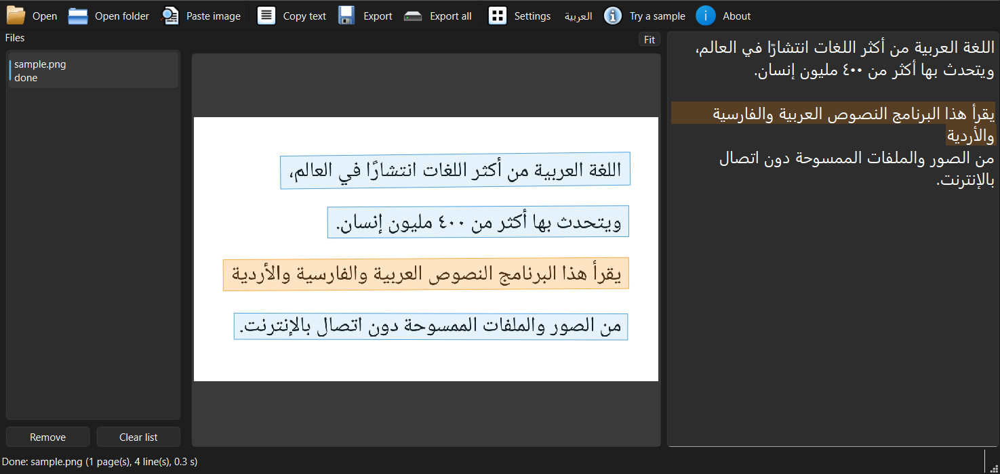

# arabic-ocr

Offline OCR for **Arabic, Persian and Urdu** text in images and PDFs, with its own
detection and recognition models. Runs on Windows, macOS and Linux, on the CPU,
with nothing sent over the internet. Apache-2.0.



- **Desktop app**: open, drag and drop, or paste a screenshot. See each line's
  box next to its text, correct the text, and export.
- **Outputs**: plain text, JSON (with boxes and confidence), **searchable PDF**,
  hOCR, ALTO XML. Diacritics (tashkeel) kept or removed; digits as printed,
  0–9 or ٠–٩.
- **Command line, Python library and a local HTTP API** for batch work and other apps.
- Text comes out in logical order, columns right to left.

## Install

Download the installer for your system from the
[latest release](https://github.com/youssef-mhmd/arabic-ocr/releases/latest).
No Python is needed.

| Windows 10/11 | macOS 14+ (Apple Silicon) | Ubuntu 22.04+ |
|---|---|---|
| `…-windows-x64-setup.exe` | `…-macos-arm64.dmg` | `…_amd64.deb` |

The installers are not code-signed yet, so Windows and macOS show a warning the
first time. **[Install guide](docs/install.md)** explains each step.

## Use

```bash
arabic-ocr page.png                          # print the text
arabic-ocr scan.pdf -f pdf -o searchable.pdf # searchable PDF
arabic-ocr ./scans -f json -o results/       # a whole folder
arabic-ocr page.png --no-diacritics --digits western
arabic-ocr serve                             # local HTTP API on 127.0.0.1:8000
```

```python
from arabic_ocr import OCR

doc = OCR().read("page.png")
print(doc.text)
for line in doc.lines:
    print(line.box, line.text, line.confidence)
```

- [Command-line reference](docs/cli.md) (also the HTTP API)
- [Python library reference](docs/library.md)

## Accuracy

Character error rate (CER, lower is better) on real test pages, diacritics ignored:

| Content | CER | v1 target |
|---|---|---|
| Printed Arabic (scanned books) | 1.40% | ≤ 2% |
| Printed Arabic, diacritics counted | 1.50% | ≤ 6% |
| Screenshots (common UI and document fonts) | 0.85% | ≤ 1% |
| Persian, modern print (scans / digital) | 3.07% / 0.18% | ≤ 4% |
| Urdu, modern print (digital) | 0.27% | ≤ 4% |

An A4 page at 300 DPI takes about 1.5 s on 4 CPU cores. Nastaliq script,
handwriting and photos of signs are not supported yet. See the
[requirements](docs/PRD.md) and [milestones](docs/milestones.md).

## Development

Requires [uv](https://docs.astral.sh/uv/).

```bash
uv sync --extra gui          # runtime + desktop app + dev + data-generation dependencies
uv run arabic-ocr-gui        # the desktop app from source
uv run pytest                # tests
uv run ruff check . && uv run ruff format .
uv run python -m installers.build   # build the installer for this OS (see installers/README.md)
```

Training (needs an NVIDIA GPU; CUDA PyTorch is about 3 GB):

```bash
uv sync --group train
uv run python -m training.download_fonts    # training fonts (~27 MB)
uv run python -m training.corpora download && uv run python -m training.corpora prepare
uv run python -m training.make_dataset training/configs/data_sample.yaml
```

- Requirements: [docs/PRD.md](docs/PRD.md) · Plan: [docs/milestones.md](docs/milestones.md)
- ML learning notes: [docs/learning/](docs/learning/)

## License

Code: [Apache-2.0](LICENSE). Models: CC BY-SA 4.0, because they were trained on
Wikipedia and Wikisource text (attribution in [NOTICE](NOTICE)). Data and font
licenses are tracked in [data/LICENSES.md](data/LICENSES.md). The desktop app
uses Qt (PySide6) under the LGPL-3.0.
